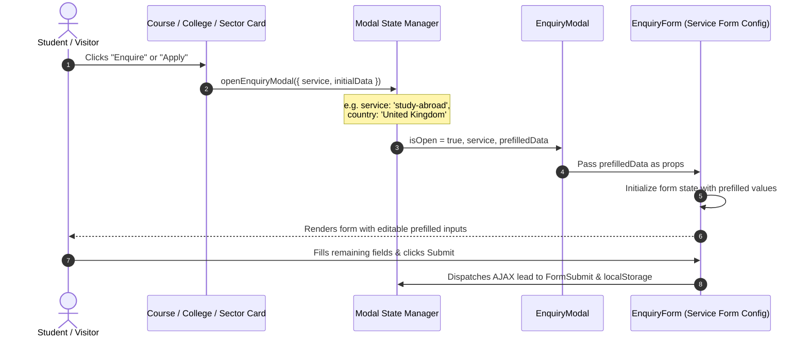
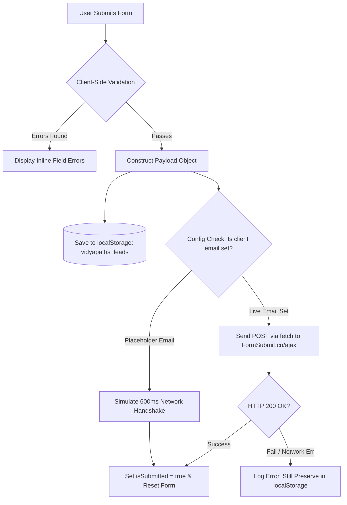

# Vidyapaths — System Architecture & Data Flow

> **Technical architecture reference** detailing the frontend framework, routing topology, component hierarchy, modal state pipelines, lead dispatch architecture, and static data contracts.

---

## 1. Architectural Overview

Vidyapaths is engineered as a high-performance, client-side Single Page Application (SPA). It leverages a decoupled presentation layer with zero server-side operational dependencies, enabling rapid edge-network distribution, instantaneous route transitions, and robust client-side lead capture.

```mermaid
flowchart TD
    subgraph Client Application [React 19 Single Page Application]
        Router[React Router DOM v7] --> Layout[Global Layout Wrapper]
        Layout --> Scroll[ScrollToTop Handler]
        Layout --> Nav[Sticky Navbar]
        Layout --> View[Active Route View]
        Layout --> Foot[Global Footer]
        Layout --> Float[WhatsApp Floating Action]
        Layout --> Modals[Enquiry & Comparison Modals]
    end

    subgraph Static Data Layer [Client-Side Data Stores]
        CollegesData[(src/data/colleges.js)]
        CountriesData[(src/data/countriesData.js)]
        FormConfigs[(src/data/serviceFormConfigs.js)]
        SiteConfig[(src/data/siteData.js)]
    end

    subgraph Lead Transport Layer
        FormSubmit[FormSubmit.co AJAX Endpoint]
        LocalStore[(localStorage: vidyapaths_leads)]
    end

    View -.->|Consumes Data| Static Data Layer
    Modals -.->|Consumes Schema| FormConfigs
    Modals -->|Submits Lead| FormSubmit
    Modals -->|Caches Backup| LocalStore
```

---

## 2. Technology Stack & Key Dependencies

| Layer | Technology | Version | Purpose & Rationale |
| :--- | :--- | :--- | :--- |
| **Runtime / Library** | **React** | `19.2.8` | Declarative UI library utilizing the latest concurrent rendering features. |
| **Build Tooling** | **Vite** | `^8.3.0` | Ultra-fast ESM-native build engine providing sub-second HMR and optimized rollups. |
| **Styling Framework** | **Tailwind CSS** | `^4.3.3` | High-efficiency utility-first styling with `@tailwindcss/vite` JIT compiler. |
| **Client-Side Routing**| **React Router** | `^7.18.4` | Declarative route rendering, location history management, and route alias mappings. |
| **Iconography** | **Lucide React** | `^1.54.0` | Clean, modular SVG icons bundled with tree-shaking support. |
| **Code Quality** | **Oxlint** | `^1.81.0` | Rust-powered high-speed JavaScript and JSX linter. |
| **Testing Harness** | **Puppeteer Core** | `^25.13.0` | Headless Chrome automation for DOM verification and form flow testing. |

---

## 3. Component Hierarchy & Application Shell

The application root (`src/App.jsx`) wraps the application shell in `BrowserRouter`:

```
App
├── ScrollToTop (Route & Hash change watcher, 90px sticky header offset)
├── Navbar (Sticky navigation, mobile drawer state, global CTA)
├── Main Content Container (<Routes>)
│   ├── Route: / (Home)
│   ├── Route: /about (About)
│   ├── Route: /services (Services)
│   ├── Route: /colleges (Colleges)
│   ├── Route: /study-abroad (StudyAbroad)
│   ├── Route: /internships (Internships)
│   ├── Route: /internships-admissions (Alias -> Internships)
│   ├── Route: /contact (Contact)
│   ├── Route: /privacy-policy (PrivacyPolicy)
│   ├── Route: /privacy (Alias -> PrivacyPolicy)
│   ├── Route: /terms-of-service (TermsOfService)
│   ├── Route: /terms (Alias -> TermsOfService)
│   └── Route: * (Catch-all Fallback -> Home)
├── Footer (Brand links, service menu, contact coordinates, copyright)
├── WhatsAppButton (Floating persistent quick-chat trigger)
└── Global Modal Layer
    ├── EnquiryModal (Controlled by App/Page state, renders EnquiryForm)
    └── CollegeComparisonModal (Controlled by Colleges page, renders ComparisonRequestForm)
```

---

## 4. Modal System & Dynamic Prefill Pipeline

One of the platform's core architectural strengths is its **context-aware lead prefill system**. Rather than presenting a generic contact form, the UI passes contextual parameters into the modal:



### Prefill Triggers Matrix:
1. **Course Cards (`Home.jsx`):** Emits `{ service: 'college-admissions', course: 'B.Tech / B.E.' }`.
2. **College Cards (`Colleges.jsx`):** Emits `{ service: 'college-admissions', college: 'Hindu College' }`.
3. **College Program Cards (`Colleges.jsx`):** Emits `{ service: 'college-admissions', college: '...', course: '...' }`.
4. **Country Cards (`StudyAbroad.jsx`):** Emits `{ service: 'study-abroad', country: 'Germany' }`.
5. **Internship Sectors (`Internships.jsx`):** Emits `{ service: 'internship-assistance', domain: 'Software & Web Development' }`.

---

## 5. Lead Ingestion & Dispatch Pipeline

Lead handling combines zero-backend simplicity with enterprise-grade data retention:



### Lead Object Schema:
```json
{
  "id": "lead_1728639201948",
  "service": "college-admissions",
  "fullName": "Aryan Singh",
  "email": "aryan@example.com",
  "phone": "9876543210",
  "preferredCourse": "B.Tech / B.E.",
  "preferredCollege": "Delhi Technological University (DTU)",
  "location": "Delhi NCR",
  "timestamp": "2026-10-11T10:26:41.948Z",
  "sourceUrl": "https://vidyapaths.com/colleges"
}
```

---

## 6. Directory Structure & Architectural Conventions

```
Vidyapaths/
├── public/                     # Static edge assets (favicon, robots.txt, sitemap.xml)
├── src/
│   ├── components/             # Reusable UI widgets and structural layout modules
│   │   ├── Button.jsx          # Polymorphic button primitive with style variants
│   │   ├── Card.jsx            # Bordered/shadowed responsive container primitive
│   │   ├── CollegeComparisonModal.jsx # Dedicated comparison request dialog
│   │   ├── ComparisonRequestForm.jsx  # Controlled comparison enquiry inputs
│   │   ├── EnquiryForm.jsx     # Dynamic multi-service enquiry form engine
│   │   ├── EnquiryModal.jsx    # Global responsive dialog container
│   │   ├── Footer.jsx          # Site-wide multi-column footer
│   │   ├── Navbar.jsx          # Responsive sticky navigation and mobile drawer
│   │   ├── ScrollToTop.jsx     # Window scroll watcher & anchor scroll offset
│   │   └── WhatsAppButton.jsx  # Floating bottom-right direct contact trigger
│   ├── data/                   # Static headless data models
│   │   ├── colleges.js         # Directory of 80+ institutions with cutoffs
│   │   ├── countriesData.js    # 9 destination countries with cost/visa criteria
│   │   ├── serviceFormConfigs.js # Dynamic field schemas for 8 service types
│   │   └── siteData.js         # Centralized company metadata & contact tokens
│   ├── pages/                  # Page-level route views
│   │   ├── About.jsx           # Mission, philosophy, and team advisory
│   │   ├── Colleges.jsx        # Searchable directory with stream filtering
│   │   ├── Contact.jsx         # Contact coordinates & direct booking form
│   │   ├── Home.jsx            # High-conversion landing page
│   │   ├── Internships.jsx     # Corporate readiness tracks & process anchor
│   │   ├── PrivacyPolicy.jsx   # Data protection terms
│   │   ├── Services.jsx        # Full service catalog & FAQs
│   │   ├── StudyAbroad.jsx     # Global education dossiers & admission steps
│   │   └── TermsOfService.jsx  # Terms & conditions
│   ├── utils/
│   │   └── usePageMeta.js      # Dynamic page title & description hook
│   ├── App.jsx                 # Routing declaration & global modal binding
│   ├── index.css               # Tailwind CSS v4 entry & custom styles
│   └── main.jsx                # Application DOM entry point
├── docs/                       # Project technical documentation suite
├── index.html                  # HTML entry point with meta tags & Google fonts
├── package.json                # Dependencies, scripts, and build manifest
└── vite.config.js              # Vite 8 & Tailwind v4 plugin configuration
```

---

## 7. Performance & Optimization Principles

1. **Zero External CSS Bloat:** Tailwind CSS v4 generates atomic utility classes strictly for code in use.
2. **SVG Icon Inlining:** `lucide-react` icons are compiled directly into the virtual DOM without extra font requests.
3. **Sub-second Font Rendering:** Google Fonts (`Poppins` and `Inter`) are fetched using `<link rel="preconnect">` tags in `index.html`.
4. **Browser Cache Retention:** Static data modules (`colleges.js`, `countriesData.js`) are bundled into the production chunk and cached by browser service layers and CDNs.
