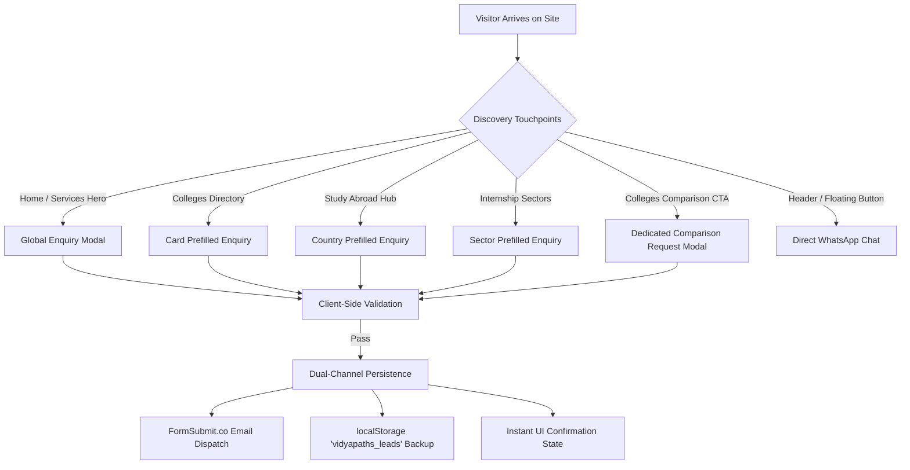

# Vidyapaths — Project Brain & Core Architecture

> **Single Source of Truth** for project philosophy, brand strategy, design rationale, architectural constraints, and future evolution of the Vidyapaths platform.

---

## 1. Project Identity & Mission

**Vidyapaths** is a high-conversion, student-centric career and education consultancy platform. Its primary mission is to democratize ethical, transparent, and structured academic guidance for students navigating higher education, career transitions, competitive admissions, internship opportunities, and international study.

- **Brand Slogan:** *"Right Guidance. Brighter Future."*
- **Core Value Proposition:** Unbiased, student-first mentoring backed by authentic institution criteria, cutoffs, and transparent admission guidance—free from the commercial bias often found in commission-driven consultancy models.

---

## 2. Target Audience & User Personas

Vidyapaths caters to four distinct user archetypes:

1. **High School Students (Classes 10–12 / Intermediate):**
   - *Needs:* Stream selection, competitive entrance exam pathways (JEE, CUET, NEET, CLAT), undergraduate college cutoffs, direct vs. entrance admission eligibility.
   - *Key Actions:* Browsing UG courses (B.Tech, BBA, BCA, B.Com, BJMC), requesting free counselling calls, comparing universities.

2. **Undergraduates & Fresh Graduates:**
   - *Needs:* Postgraduate program selection (MBA, MCA, M.Tech, M.Com), corporate readiness, skill gap identification, resume/interview coaching, verified internships.
   - *Key Actions:* Submitting internship assistance enquiries, applying for resume reviews, exploring postgraduate colleges.

3. **Global Education Seekers:**
   - *Needs:* Country selection, visa criteria, tuition budgets, post-study work permits (PSWP), intake timelines, and English proficiency testing (IELTS, TOEFL, PTE).
   - *Key Actions:* Browsing destination country profiles (UK, USA, Canada, Australia, Germany, Ireland, etc.), submitting overseas application requests.

4. **Parents & Guardians:**
   - *Needs:* Verification of institution credibility, safety, fee structures, return on investment (ROI), and reliable career outlook.
   - *Key Actions:* Direct WhatsApp contact, phone enquiries, scheduling 1-on-1 counsellor consultations.

---

## 3. Brand Identity & Visual Language

The visual system is engineered to inspire trust, intellectual ambition, and modern approachability:

| Attribute | Specification | Design Rationale |
| :--- | :--- | :--- |
| **Primary Navy** | `#0B1F3A` | Evokes institutional stability, authority, academic prestige, and trust. |
| **Secondary Navy** | `#1E3A8A` / `#0F172A` | Provides depth and structural contrast for cards and banners. |
| **Accent Orange** | `#FF5722` | Communicates youthful energy, actionable urgency, optimism, and growth. |
| **Neutral White** | `#FFFFFF` & `#F8FAFC` | Maximizes readability, clean whitespace, and modern minimalism. |
| **Headings Font** | **Poppins** (600/700/800) | Modern geometric sans-serif that projects confidence and authority. |
| **Body Font** | **Inter** (400/500/600) | Highly legible sans-serif optimized for screens, UI controls, and forms. |

### Visual Principles:
- **Clean Whitespace:** Generous margins and paddings prevent cognitive fatigue.
- **Micro-Interactions:** Subtle scale and shadow hover transitions (`hover:-translate-y-1`, `hover:shadow-xl`) give an engaging native-app feel.
- **Zero Clutter:** No superfluous animated banners, intrusive pop-up spam, or generic unbranded stock photography.

---

## 4. Architectural Constraints & Boundaries (MVP Scope)

The current release is an optimized **Static Single Page Application (SPA)** built with React 19 and Vite 8. It delivers production-grade lead generation at zero hosting operational cost.

### Explicitly Excluded from Current MVP:
1. **No User Authentication:** No student accounts, password databases, or login portals.
2. **No Live Database Backend:** All institution data, country profiles, and form schemas reside in client-side static modules.
3. **No Direct Payment Gateways:** No tuition fee checkouts or consultancy fees processed online.
4. **No Real-Time Scrapers:** No automated bots querying university portals on the fly; data is curated statically.
5. **No AI/LLM Bot Endpoints:** Enquiries are routed to human counsellors via FormSubmit and direct WhatsApp messaging.

> [!IMPORTANT]
> Any proposal to introduce server-side databases, authentication layers, or user dashboards constitutes a scope expansion beyond the MVP baseline and requires formal roadmap approval.

---

## 5. Lead Generation & Conversion Architecture

The entire user journey is calibrated around a frictionless conversion funnel:

### Lead Channels:
1. **Context-Aware Global Enquiry Modal:** Automatically pre-fills relevant academic services and items (e.g. clicking "Enquire" on a B.Tech card opens the modal with `College Admission & Guidance` selected and `B.Tech` set in the course field).
2. **Dedicated College Comparison Modal:** Gathers student academic marks, target institutions, and specializations to deliver curated comparison dossiers.
3. **Direct WhatsApp Handover:** Instant trigger carrying pre-formulated queries directly to the consultancy's executive line.
4. **Fail-Safe Local Persistence:** Every successful form submission is synchronized to `localStorage` (`vidyapaths_leads`) to prevent lead loss even if external SMTP services encounter intermittent issues.

---

## 6. Content Integrity Guidelines

To preserve brand authenticity and regulatory compliance:
- **No Fabricated Statistics:** Never show fabricated placement figures, fake 100% placement guarantees, or unverified student counts.
- **Accreditation Accuracy:** University entries distinguish explicitly between NAAC grades, AICTE/UGC recognitions, and affiliation types (State, Central, Private).
- **Non-Guaranteed Visa / Admission Claims:** Consultancy copy clearly states that admissions and visa issuances remain at the sole discretion of the respective colleges and embassies.
- **Placeholder Tokens:** Unconfirmed production tokens (e.g., telephone numbers, live WhatsApp numbers) are centralized in `src/data/siteData.js` for single-step handover updates.

---

## 7. Evolution & Future Roadmap

The codebase has been structured with modular boundaries so that subsequent phases can easily plug in enterprise backend services:

1. **Phase 2 (Headless Backend):**
   - Migration of `src/data/colleges.js` and `src/data/countriesData.js` to a headless CMS (Sanity, Strapi) or PostgreSQL (Supabase).
   - Server-side email delivery via SendGrid / Resend with webhook validation.
2. **Phase 3 (Student & Counsellor Portal):**
   - Secure authentication via Supabase Auth or Clerk.
   - Document upload vault for mark sheets, transcripts, and Statement of Purpose (SOP) drafts.
   - Real-time application tracking dashboard.
3. **Phase 4 (Interactive Tools):**
   - Live College Cutoff & Rank Predictor based on CUET/JEE percentiles.
   - Automated Study Abroad Budget & Currency Converter.
