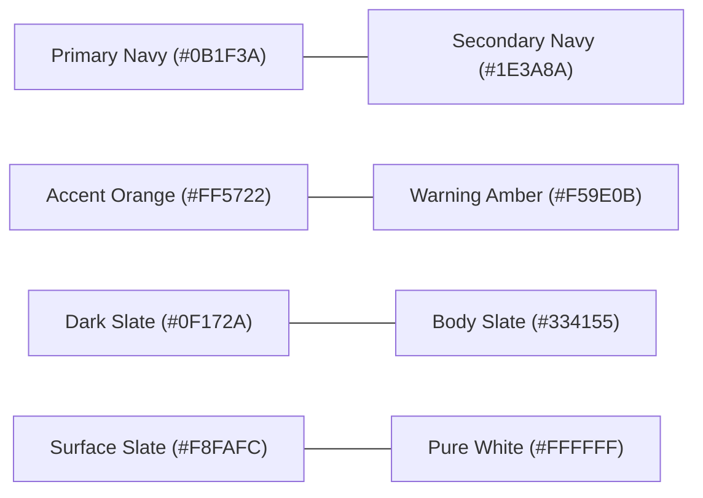

# Vidyapaths — Design System & UI Specifications

> **Comprehensive design system specification** covering brand color palettes, typographic hierarchy, component primitives, elevation, modal mechanics, and accessibility standards.

---

## 1. Design Philosophy

The Vidyapaths design language balances **academic prestige** with **youthful accessibility**. It abandons obsolete, cluttered consultancy aesthetics in favor of a crisp, spacious interface that inspires confidence in both aspiring students and discerning parents.

### Core Visual Tenets:
- **Calm Authority:** Deep navy backgrounds and clean slate typography project institutional credibility.
- **Actionable Energy:** High-contrast vibrant orange accents spotlight primary conversion paths.
- **Cognitive Clarity:** Generous whitespace, clean card outlines, and scannable visual chips minimize decision anxiety.
- **Mobile Fluidity:** Touch-friendly targets (minimum 44×44px), thumb-friendly drawers, and sticky conversion buttons.

---

## 2. Color System & Design Tokens



### Color Palette Reference

| Token Name | Hex Code | Tailwind Equivalent | Role & Application |
| :--- | :--- | :--- | :--- |
| **Primary Navy** | `#0B1F3A` | Custom / `bg-[#0B1F3A]` | Dark sections, header backgrounds, authoritative headings. |
| **Secondary Navy** | `#1E3A8A` | `bg-blue-900` | Subtle gradient accents, card headers, secondary surfaces. |
| **Accent Orange** | `#FF5722` | `bg-orange-600` / `orange-500`| Primary CTAs, highlights, badges, focus rings, hover indicators. |
| **Accent Orange Hover** | `#E64A19` | `hover:bg-orange-700` | Pressed and active button states. |
| **Slate Dark (Text)** | `#0F172A` | `text-slate-900` | High-emphasis body text, card titles. |
| **Slate Medium (Body)**| `#334155` | `text-slate-700` | Standard body paragraphs, descriptive copy. |
| **Slate Muted** | `#64748B` | `text-slate-500` | Form labels, metadata captions, secondary dates. |
| **Surface Background** | `#F8FAFC` | `bg-slate-50` | Off-white section backgrounds, filter bars, card backings. |
| **Border Gray** | `#E2E8F0` | `border-slate-200` | Subtle card borders, input borders, divider rules. |
| **Success Emerald** | `#10B981` | `text-emerald-600` / `emerald-500`| Verification badges, accredited status, form success toasts. |
| **WhatsApp Green** | `#25D366` | `bg-emerald-500` / `#25D366` | Floating WhatsApp trigger, instant chat indicators. |

---

## 3. Typography Hierarchy

The type system blends **Poppins** (for bold, geometric headlines) with **Inter** (for crisp, high-legibility interface copy and form inputs).

### Typography Scale

| Level | Size (Desktop / Mobile) | Weight | Font Family | Tailwind Classes |
| :--- | :--- | :--- | :--- | :--- |
| **Display H1** | `48px` / `32px` | 800 (Bold) | Poppins | `text-3xl md:text-5xl font-extrabold tracking-tight` |
| **Section H2** | `36px` / `26px` | 700 (Bold) | Poppins | `text-2xl md:text-4xl font-bold` |
| **Card H3** | `22px` / `18px` | 600 (Semibold) | Poppins | `text-lg md:text-xl font-semibold` |
| **Subheading / Lead** | `18px` / `16px` | 400 (Regular) | Inter | `text-base md:text-lg text-slate-600 leading-relaxed` |
| **Standard Body** | `15px` / `14px` | 400 (Regular) | Inter | `text-sm md:text-base text-slate-700 leading-normal` |
| **Caption / Meta** | `13px` / `12px` | 500 (Medium) | Inter | `text-xs md:text-sm text-slate-500` |
| **Button / Label** | `15px` / `14px` | 600 (Semibold) | Inter | `text-sm font-semibold tracking-wide` |

---

## 4. Component Design Primitives

### 4.1 Buttons (`Button.jsx`)
Buttons communicate clear visual hierarchy across four distinct variants:

```
[ Primary CTA: Orange Solid (#FF5722) ]   --> High conversion priority (Enquire, Apply)
[ Secondary CTA: Navy Solid (#0B1F3A) ]   --> Structural navigation (Explore Colleges)
[ Outline CTA: Navy/Orange Border ]      --> Supportive secondary actions (View Details)
[ Ghost CTA: Subtle Slate Hover ]        --> Inline actions & dismiss triggers
```

- **Sizing Tokens:**
  - `sm`: `px-3.5 py-1.5 text-xs font-semibold rounded-lg`
  - `md`: `px-5 py-2.5 text-sm font-semibold rounded-xl` (Default)
  - `lg`: `px-7 py-3.5 text-base font-bold rounded-xl`
- **Focus States:** Every button includes `focus:outline-none focus:ring-2 focus:ring-orange-500 focus:ring-offset-2`.

### 4.2 Cards (`Card.jsx`)
Cards serve as the primary containment element for courses, colleges, sectors, and testimonials:
- **Surface:** `bg-white border border-slate-200/80 rounded-2xl`
- **Shadow Tokens:** `shadow-sm hover:shadow-xl transition-all duration-300`
- **Transform Animation:** `hover:-translate-y-1` for interactive cards.

### 4.3 Form Inputs & Select Controls
Designed to eliminate entry fatigue:
- **Input Geometry:** `w-full px-4 py-3 rounded-xl border border-slate-200 bg-white text-slate-800 text-sm`
- **Active / Focus:** `focus:border-orange-500 focus:ring-2 focus:ring-orange-500/20 outline-none transition-all`
- **Error State:** `border-red-500 focus:border-red-500 focus:ring-red-500/20` accompanied by an SVG warning icon and micro-copy: `<span class="text-xs text-red-600 font-medium mt-1">Field is required</span>`.

### 4.4 Badges & Status Chips
- **Free Guidance:** `bg-orange-100 text-orange-700 font-semibold px-2.5 py-1 rounded-full text-xs`
- **Accreditation (NAAC A++):** `bg-emerald-50 text-emerald-700 font-semibold px-2 py-0.5 rounded-md text-xs border border-emerald-200`
- **Category Filter Chips:** `px-4 py-2 rounded-full text-sm font-medium transition-colors` (`bg-slate-900 text-white` when active; `bg-slate-100 text-slate-600 hover:bg-slate-200` when inactive).

---

## 5. Modal & Dialog Mechanics

Both `EnquiryModal.jsx` and `CollegeComparisonModal.jsx` observe strict layout and accessibility conventions:
1. **Backdrop Layer:** `fixed inset-0 z-50 bg-slate-900/60 backdrop-blur-sm animate-fade-in`.
2. **Dialog Surface:** `relative w-full max-w-xl mx-auto my-6 bg-white rounded-2xl shadow-2xl overflow-hidden`.
3. **Scrollable Content Body:** `max-h-[85vh] overflow-y-auto px-6 py-6` to ensure complete accessibility on small mobile displays.
4. **Close Affordance:** Explicit high-contrast `X` button positioned top-right (`p-2 text-slate-400 hover:text-slate-700 rounded-full hover:bg-slate-100`) as well as `Escape` key and backdrop click listeners.

---

## 6. Layout Grid & Container Bounds

| Screen Breakpoint | Container Width | Padding / Gutter |
| :--- | :--- | :--- |
| **Mobile (`<640px`)** | `100%` | `px-4 (16px)` |
| **Tablet (`640px - 768px`)** | `sm:max-w-xl` | `px-6 (24px)` |
| **Laptop (`768px - 1024px`)** | `md:max-w-4xl` | `px-6 (24px)` |
| **Desktop (`1024px - 1280px`)**| `lg:max-w-6xl` | `px-8 (32px)` |
| **Wide Display (`>1280px`)** | `max-w-7xl` (`1280px`) | `px-8 (32px) mx-auto` |

---

## 7. Accessibility & Usability (WCAG Standards)

- **Color Contrast:** All body text (`#334155` on `#FFFFFF` and `#F8FAFC`) exceeds WCAG AAA standards (> 7:1 ratio). White text on Accent Orange (`#FF5722`) exceeds WCAG AA for large text (> 3.2:1).
- **Interactive Targets:** Every clickable element is structured with minimum dimensions of `44px × 44px`.
- **Keyboard Navigation:** Native button and anchor elements preserve standard tab orders and explicit `:focus-visible` outlines.
