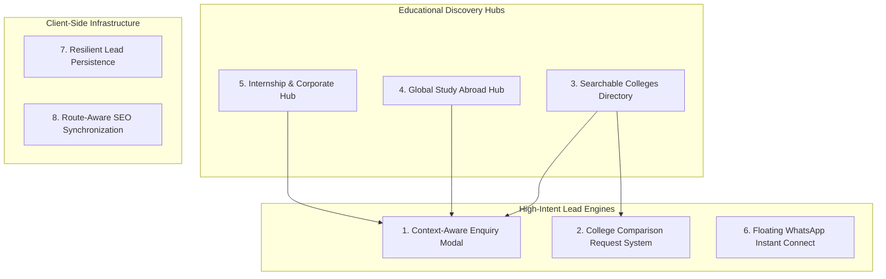

# Vidyapaths — Feature Catalog & Capabilities

> **Complete inventory of implemented features**, functional workflows, contextual triggers, and boundary definitions distinguishing live functionality from future planned enhancements.

---

## 1. Feature Architecture Overview

---

## 2. Implemented Features Deep-Dive

### Feature 1: Context-Aware Global Enquiry Modal
- **Components:** `src/components/EnquiryModal.jsx`, `src/components/EnquiryForm.jsx`, `src/data/serviceFormConfigs.js`
- **Description:** A modal dialog that adapts its form fields dynamically based on the selected educational service.
- **Service Schemas Supported:**
  1. `college-admissions` (College Admission & Guidance)
  2. `career-counselling` (Career Counselling)
  3. `study-abroad` (Study Abroad Guidance)
  4. `internship-assistance` (Internship Assistance)
  5. `career-roadmap` (Career Roadmap & Planning)
  6. `college-comparison` (College Comparison & Shortlisting)
  7. `resume-interview` (Resume & Interview Preparation)
  8. `scholarships-loans` (Scholarship & Education Loan Advisory)
- **Dynamic Field Prefill:**
  - When invoked from a course card: Automatically selects `college-admissions` and pre-populates `preferredCourse` (e.g. `B.Tech / B.E.`).
  - When invoked from a college card: Automatically selects `college-admissions` and pre-populates `preferredCollege` (e.g. `Hindu College`).
  - When invoked from a country card: Automatically selects `study-abroad` and pre-populates `country` (e.g. `United Kingdom`).
  - When invoked from an internship sector card: Automatically selects `internship-assistance` and pre-populates `internshipDomain` (e.g. `Software & Web Development`).
- **User Control:** All pre-filled fields remain completely editable by the student.

---

### Feature 2: Dedicated College Comparison Request System
- **Components:** `src/components/CollegeComparisonModal.jsx`, `src/components/ComparisonRequestForm.jsx`
- **Trigger:** "Get Free College Comparison" banner on the Colleges Directory page (`/colleges`).
- **Modal Heading:** *"Compare Colleges With Confidence"* with supporting copy and a `"FREE GUIDANCE"` pill badge.
- **Form Fields:**
  - **Student Name** (Text, Required)
  - **Phone Number** (Tel, 10-digit Indian standard regex, Required)
  - **Email Address** (Email, Optional)
  - **Current Academic Score / Percentage** (Text, e.g. "88% in 12th" or "8.2 CGPA", Required)
  - **Current Qualification / Class** (Dropdown: 12th Appearing, 12th Passed, Undergraduate Final Year, Graduate, Other, Required)
  - **Preferred Course / Stream** (Text, e.g. "B.Tech CSE, MBA Finance", Required)
  - **Colleges You Want to Compare** (Textarea, e.g. "DTU vs NSUT vs Thapar", Required)
  - **Specific Factors to Compare** (Checkboxes: Fees, Placements, Cutoffs & Eligibility, Faculty & Campus, Location / Hostel, Accreditation)
  - **Additional Questions / Notes** (Textarea, Optional)
- **Note on Budget Field:** As requested during design refinement, the "Maximum Annual Tuition Budget" field was intentionally removed to minimize user friction.
- **Output:** Packages request into a structured dossier payload and dispatches it via FormSubmit and local cache.

---

### Feature 3: Interactive Colleges Directory
- **Component:** `src/pages/Colleges.jsx`
- **Data Source:** `src/data/colleges.js` (80+ institutions curated across Delhi NCR & India)
- **Search Capabilities:** Live text query search matching college name, acronym, location, or course names.
- **Stream Category Filter:**
  - All Streams
  - Engineering & Technology (B.Tech, M.Tech)
  - Management & Commerce (BBA, MBA, B.Com)
  - IT & Computer Applications (BCA, MCA)
  - Science & Medical (B.Sc, MBBS, BDS, Pharmacy)
  - Humanities & Social Sciences (BA, MA, BJMC)
  - Law (BA LLB, BBA LLB, LLM)
  - Design & Media (B.Des, Animation)
- **Institution Type Filter:** Central University, State University, Private University, Deemed-to-be-University, Autonomous Institute.
- **Rich Institution Cards:**
  - Verified NAAC grade badges (e.g., NAAC A++, NAAC A+).
  - Institution type and campus location.
  - Featured programs list with duration.
  - Typical cutoff scores and entrance exam criteria (CUET, JEE, CAT, CLAT).
  - External link button opening the institution's official admissions portal (`target="_blank" rel="noopener noreferrer"`).
  - "Get Admission Guidance" button opening the pre-filled enquiry modal.

---

### Feature 4: Global Study Abroad Hub
- **Component:** `src/pages/StudyAbroad.jsx`
- **Data Source:** `src/data/countriesData.js`
- **Coverage:** 9 key global destinations:
  1. United Kingdom (UK)
  2. United States of America (USA)
  3. Canada
  4. Australia
  5. Germany
  6. Ireland
  7. New Zealand
  8. United Arab Emirates (UAE)
  9. Singapore
- **Comprehensive Country Profiles:**
  - Flag visual and country overview.
  - Premier institutions (e.g. Oxford, MIT, Toronto, Melbourne, TU Munich).
  - Average annual tuition fees in INR/GBP/USD.
  - Average living expenses and accommodation estimates.
  - Post-Study Work Permit (PSWP) rights and stay-back duration.
  - Primary intake months (Fall/September, Spring/January, Summer).
  - Standardized test prerequisites (IELTS, TOEFL, GRE, GMAT).
- **Direct Country CTA:** Each country card features an "Apply" button dynamically linked to the Study Abroad form with the destination country prefilled.

---

### Feature 5: Internship & Corporate Readiness Hub
- **Component:** `src/pages/Internships.jsx`
- **Sector Coverage:** 6 high-demand professional sectors:
  1. Software & Web Development (Frontend, Backend, Full Stack, Mobile)
  2. Digital Marketing & Growth (SEO, Performance Marketing, Social Media)
  3. Business & Sales Development (B2B Sales, Client Relations, Lead Generation)
  4. Finance & Data Analysis (Financial Modeling, Excel, PowerBI, Python)
  5. Content & Media (Copywriting, Technical Writing, Video Production)
  6. Graphic & UI/UX Design (Figma, Brand Identity, Visual Design)
- **Contextual Sector CTAs:** "Apply" button on each sector card opens the enquiry modal with `internship-assistance` pre-selected and the specific domain prefilled.
- **Roadmap Anchor Navigation:** The "Explore Process" hero CTA executes smooth scrolling directly to the `#internship-process` section with 90px sticky header compensation.
- **Readiness Pillars:** Dedicated sections covering ATS-compliant resumes, GitHub/portfolio reviews, mock technical interviews, and corporate etiquette.

---

### Feature 6: Responsive Shell & Floating WhatsApp Trigger
- **Components:** `src/components/Navbar.jsx`, `src/components/Footer.jsx`, `src/components/WhatsAppButton.jsx`
- **Sticky Header:** Persistent desktop navigation bar with glassmorphism backdrop blur on scroll, instant call CTA, and mobile slide-out drawer.
- **Floating WhatsApp Widget:** Fixed bottom-right round action button (`#25D366`) configured with pre-encoded enquiry query parameters (`https://wa.me/919876543210?text=...`).

---

### Feature 7: Resilient Dual-Channel Lead Pipeline
- **Components:** Form handlers across `EnquiryForm.jsx` and `ComparisonRequestForm.jsx`
- **External Dispatch:** Submits data asynchronously to FormSubmit AJAX endpoint without page reload.
- **Local Cache Persistence:** Every submission writes to `localStorage['vidyapaths_leads']` as an indexed JSON array, protecting against loss if internet connectivity fluctuates.

---

### Feature 8: Dynamic SEO Synchronization
- **Hook:** `src/utils/usePageMeta.js`
- **Behavior:** Synchronizes browser tab title (`document.title`) and `<meta name="description">` whenever the user navigates between routes.

---

## 3. Implemented vs. Planned Features Boundary

| Capability | Current State in MVP | Future Planned Implementation |
| :--- | :--- | :--- |
| **College Directory** | Static curated dataset (`colleges.js`) | Dynamic API with database search & pagination |
| **College Comparison**| Structured request form for counsellor dossier | Live side-by-side cutoff & fee comparison table |
| **Enquiry Submission**| FormSubmit AJAX + `localStorage` | Direct backend API (PostgreSQL/Supabase + CRM webhook) |
| **Student Accounts** | Not included | Student login, application dashboard, document vault |
| **Consultancy Fees** | Free guidance CTAs; no billing | Razorpay payment gateway integration |
| **Live Chat** | Direct WhatsApp redirect | In-app real-time counsellor chat |
