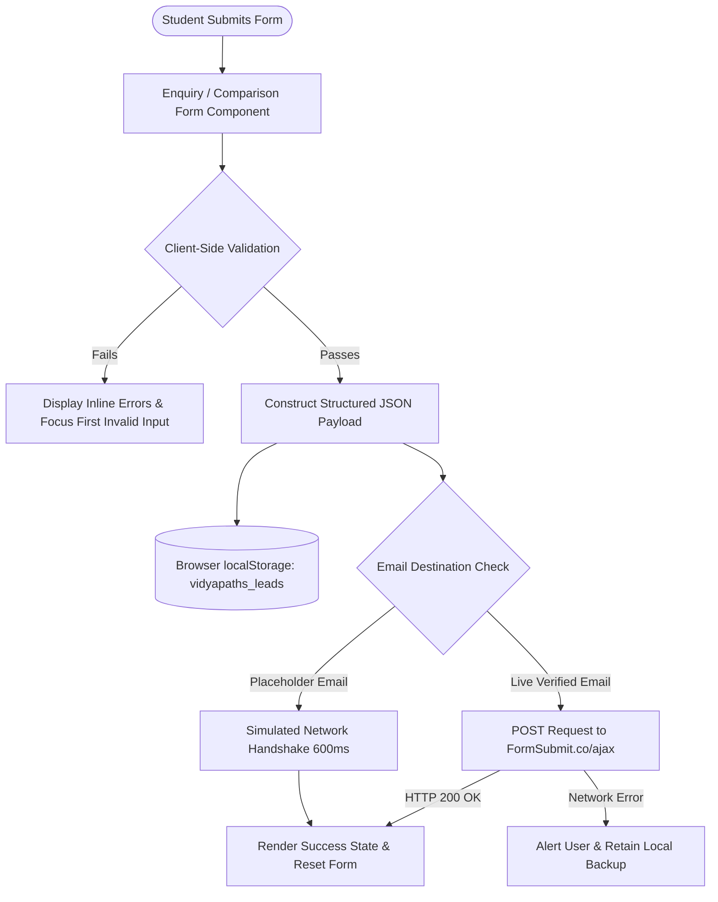

# Vidyapaths — Forms & External Integrations

> **Complete integration reference** covering dynamic form configuration schemas, client-side validation rules, FormSubmit email transport, local storage caching, and WhatsApp link generation.

---

## 1. Lead Capture Architecture

Vidyapaths operates on a **dual-transport lead ingestion pipeline**. Leads submitted by prospective students are simultaneously transmitted to the client's email box via FormSubmit.co and securely cached in the browser's `localStorage` to ensure zero lead loss.



---

## 2. Dynamic Service Form Schemas (`serviceFormConfigs.js`)

The dynamic form engine renders specialized inputs based on the selected educational track. The schemas are defined in `src/data/serviceFormConfigs.js`:

### 2.1 College Admission & Guidance (`college-admissions`)
- **Common Fields:** Full Name, Phone Number, Email, Current City / State.
- **Specific Fields:**
  - `preferredCourse` (Text, with prefill capability, e.g. "B.Tech / B.E.", "MBA")
  - `preferredCollege` (Text, with prefill capability, e.g. "Delhi University")
  - `academicBackground` (Dropdown: 12th Appearing, 12th Passed, Graduate)
  - `admissionType` (Dropdown: Merit / Cutoff Guidance, Direct Admission, Management Quota)

### 2.2 Career Counselling (`career-counselling`)
- **Specific Fields:**
  - `currentEducation` (Dropdown: Class 10th, Class 11-12th, College Student, Working Professional)
  - `careerConfusion` (Textarea: Specific questions or stream dilemmas)
  - `preferredMode` (Radio: Online Video Call, In-Person Consultation)

### 2.3 Study Abroad Guidance (`study-abroad`)
- **Specific Fields:**
  - `country` (Dropdown / Text, with prefill capability: UK, USA, Canada, Australia, Germany, Ireland, etc.)
  - `targetDegree` (Dropdown: Bachelor's Degree, Master's / Postgraduate, Diploma)
  - `testStatus` (Dropdown: IELTS/TOEFL Taken, Planning to Take, Seeking Test Guidance)
  - `intakeYear` (Dropdown: 2026 Fall, 2027 Spring, Later)

### 2.4 Internship Assistance (`internship-assistance`)
- **Specific Fields:**
  - `internshipDomain` (Dropdown / Text, with prefill capability: Software, Marketing, Finance, Design, etc.)
  - `currentYear` (Dropdown: 1st Year, 2nd Year, 3rd/4th Year, Recent Graduate)
  - `skillsResume` (Textarea: Top technical skills or LinkedIn profile link)

### 2.5 Additional Supported Schemas
- `career-roadmap`: Comprehensive long-term 3-year academic roadmap.
- `college-comparison`: University shortlisting criteria.
- `resume-interview`: ATS resume review and mock interview scheduling.
- `scholarships-loans`: Education loan eligibility and government scholarship guidance.

---

## 3. Dedicated College Comparison Form Schema

Rendered inside `src/components/ComparisonRequestForm.jsx`:

| Field Name | Type | Validation / Requirements | Notes |
| :--- | :--- | :--- | :--- |
| `fullName` | Text | Required (min 2 chars) | Student or parent name. |
| `phone` | Tel | Required (`^[6-9]\d{9}$` or 10 digits) | Primary WhatsApp / phone contact. |
| `email` | Email | Optional (valid email if provided) | For delivering comparison PDF dossier. |
| `academicScore` | Text | Required | e.g. "86% in 12th CBSE" or "8.1 CGPA". |
| `currentClass` | Select | Required | 12th Appearing, 12th Passed, Graduate, etc. |
| `preferredCourse`| Text | Required | e.g. "B.Tech Computer Science". |
| `collegesToCompare`| Textarea | Required (min 5 chars) | Names of 2–4 target institutions. |
| `comparisonFactors`| Checkbox Group | Optional | Fees, Cutoffs, Placements, Campus, Faculty. |
| `notes` | Textarea | Optional | Specific queries or reservations. |

> [!NOTE]
> The **"Maximum Annual Tuition Budget"** field was deliberately excised from this form during the UI optimization sprint to minimize submission friction while retaining all comparative parameters.

---

## 4. FormSubmit.co Email Integration

Form submissions are dispatched asynchronously via AJAX POST requests to FormSubmit.co:

### API Request Specification
- **Endpoint:** `https://formsubmit.co/ajax/${siteConfig.formSubmitEmail}`
- **HTTP Method:** `POST`
- **Request Headers:**
  ```http
  Content-Type: application/json
  Accept: application/json
  ```
- **Standard Payload Body:**
  ```json
  {
    "_subject": "New Vidyapaths Enquiry — College Admission & Guidance",
    "_template": "table",
    "_captcha": "false",
    "Service": "College Admission & Guidance",
    "Full Name": "Aryan Singh",
    "Phone Number": "+91 98765 43210",
    "Email": "aryan@example.com",
    "Preferred Course": "B.Tech Computer Science",
    "Preferred College": "Delhi Technological University (DTU)",
    "Source Page": "/colleges",
    "Submission Time": "11/10/2026, 3:45:00 PM"
  }
  ```

### FormSubmit One-Time Activation Workflow
When deploying with a new production email address in `src/data/siteData.js`:
1. Submit the first test form on the live website.
2. FormSubmit will send an automated **"Confirm your email address"** email to the inbox.
3. Click the activation link in the email once.
4. All subsequent student enquiries will arrive directly in the inbox instantly.

---

## 5. Local Storage Lead Cache (`vidyapaths_leads`)

To guarantee data safety regardless of network interruptions or third-party email downtime, every successful submission is serialized to browser cache:

- **Storage Key:** `vidyapaths_leads`
- **Format:** JSON Array of lead objects.
- **Viewing Stored Leads in Developer Console:**
  ```javascript
  const leads = JSON.parse(localStorage.getItem('vidyapaths_leads') || '[]');
  console.table(leads);
  ```
- **Exporting Leads to JSON:**
  ```javascript
  copy(localStorage.getItem('vidyapaths_leads'));
  ```

---

## 6. WhatsApp Click-to-Chat Integration

The platform provides friction-free WhatsApp connectivity via `src/components/WhatsAppButton.jsx` and inline CTAs:

### URI Generation Logic
```javascript
const phoneClean = siteConfig.whatsappNumber.replace(/[^0-9]/g, '');
const encodedText = encodeURIComponent(siteConfig.whatsappMessage);
const whatsappUrl = `https://wa.me/${phoneClean}?text=${encodedText}`;
```

- **Target Attribute:** `target="_blank" rel="noopener noreferrer"`
- **Default Message:** *"Hi Vidyapaths, I would like to get free counselling guidance for my education & career."*

---

## 7. Handover Token Configuration (`siteData.js`)

All production contact details and email targets are maintained in `src/data/siteData.js`:

```javascript
export const siteConfig = {
  name: "Vidyapaths",
  tagline: "Right Guidance. Brighter Future.",
  phone: "+91 98765 43210",               // Display phone
  phoneRaw: "+919876543210",             // Dialable phone
  whatsappNumber: "+919876543210",       // International format without '+'
  whatsappMessage: "Hi Vidyapaths, ...",
  email: "admissions@vidyapaths.com",     // Visible contact email
  formSubmitEmail: "admissions@vidyapaths.com", // FormSubmit recipient target
  address: "Knowledge Park, Sector 62, Noida, Uttar Pradesh 201309, India",
  hours: "Mon - Sat: 9:30 AM - 6:30 PM",
  socials: { ... }
};
```
