# Vidyapaths — Implementation Plan & Milestone History

> **Chronological breakdown** of project phases, executed sprints, interactive feature refactors, architectural milestones, and the future expansion roadmap.

---

## 1. Implementation Overview

The Vidyapaths platform was constructed iteratively following a strict phased delivery model: establishing brand tokens and design primitives first, assembling modular page layouts second, integrating high-converting lead mechanisms third, and refining dynamic pre-fill capabilities and automated testing fourth.

```mermaid
flowchart LR
    P0[Phase 0: Requirements & Token Setup] --> P1[Phase 1: Architecture & Scaffolding]
    P1 --> P2[Phase 2: Design System & Primitives]
    P2 --> P3[Phase 3: Global Shell & Layout]
    P3 --> P4[Phase 4: Page Construction & Directory]
    P4 --> P5[Phase 5: Lead Forms & Contextual Prefill]
    P5 --> P6[Phase 6: SEO & Anchor Navigation]
    P6 --> P7[Phase 7: Testing & Documentation Handover]
```

---

## 2. Phase-by-Phase Milestone History

### Phase 0: Requirements Definition & Discovery
- **Scope Definition:** Defined target student personas, core consultancy pillars, and business conversion objectives.
- **Data Cataloging:** Researched and compiled curriculum data for undergraduate and postgraduate courses, entrance exams (CUET, JEE, CAT, CLAT), and top international destinations.
- **Deliverables:** Baseline specification documents (`BRAIN.md`, `PAGE_STRUCTURE.md`, `LEAD_FORM_SPEC.md`).

### Phase 1: Project Scaffolding & Toolchain
- **Vite & React 19:** Initialized modern React single-page application using Vite 8 for sub-second hot module reloading.
- **Tailwind CSS v4:** Configured `@tailwindcss/vite` v4 compiler with inline `@theme` font family and brand palette declarations.
- **Routing Engine:** Integrated `react-router-dom` v7 with path configurations, catch-all 404 redirection, and route aliases (`/internships-admissions`, `/privacy`, `/terms`).
- **Iconography:** Installed `lucide-react` for lightweight, tree-shakeable SVG icons.

### Phase 2: Design System & UI Foundations
- **Color Tokenization:** Implemented Primary Navy (`#0B1F3A`), Secondary Navy (`#1E3A8A`), Accent Orange (`#FF5722`), and slate neutrals.
- **Typography Scale:** Configured Google Fonts (Poppins for display headers, Inter for functional UI and copy).
- **Component Primitives:** Built reusable `Button` variants (primary, secondary, outline, ghost), card containers, and badge tags.

### Phase 3: Global Layout & Shell
- **Sticky Navbar (`src/components/Navbar.jsx`):** Developed desktop header with brand logo, route navigation links, contact button, and mobile hamburger drawer.
- **Global Footer (`src/components/Footer.jsx`):** Engineered multi-column footer with quick links, service catalog, contact coordinates, and copyright statement.
- **Floating WhatsApp Widget (`src/components/WhatsAppButton.jsx`):** Deployed persistent bottom-right action trigger connecting to executive WhatsApp chat.
- **Scroll Restoration System (`src/components/ScrollToTop.jsx`):** Resolved single-page route scroll retention by resetting viewport to top on route change and implementing smooth anchor scroll with 90px sticky header clearance.

### Phase 4: Page Assembly & Directory Data
- **Homepage (`src/pages/Home.jsx`):** Built 10 high-converting sections: Hero, Trust Stats, Services, 4-Step Process, Featured Admissions, Study Abroad, Internships, Value Proposition, Testimonials, and Conversion CTA.
- **Colleges Directory (`src/pages/Colleges.jsx`):** Curated 80+ institutions with search indexing, stream categorization, type filters, cutoffs, and official admission portal links.
- **Study Abroad Hub (`src/pages/StudyAbroad.jsx`):** Created 9 destination dossiers with admissions criteria, cost breakdowns, and visa timelines.
- **Internships Hub (`src/pages/Internships.jsx`):** Built 6 industry sector tracks, ATS resume guidance, and interview readiness framework.
- **About, Services, Contact, and Legal Pages:** Delivered comprehensive mission, full service catalog with FAQs, contact coordinates, and privacy/terms agreements.

---

## 3. Interactive Refactors & Sprints

During user acceptance testing and refinement, several targeted sprints were executed to elevate lead conversion efficiency:

### Sprint 5.1: Contextual Course Prefill on Course Cards
- **Problem:** Clicking "Get Guidance" on course cards opened the generic modal without knowing which course the student clicked.
- **Solution:** Connected each card's button to pass `{ service: 'college-admissions', courseName: course.title }` into the global modal state.
- **Verification:** Clicking "B.Tech / B.E." or "BBA" opens the modal with `College Admission & Guidance` selected and the course field prefilled and editable.

### Sprint 5.2: Study Abroad Country Prefill Fix
- **Problem:** Country card "Apply" buttons mistakenly opened the Career Counselling form.
- **Solution:** Fixed click handlers to route to `study-abroad` service schema and pre-populate the `country` field with the card's target country.
- **Verification:** "Apply UK" pre-selects Study Abroad and prefills `United Kingdom`.

### Sprint 5.3: Internship Sector Prefill & Anchor Navigation
- **Problem:** "Apply" on internship sectors did not pass the sector, and the "Explore Process" button failed to navigate to the roadmap section.
- **Solution:** 
  1. Connected sector cards to pre-fill the `internship-assistance` domain field.
  2. Assigned stable ID `internship-process` to the process section and connected "Explore Process" via smooth anchor scrolling with header offset.

### Sprint 5.4: Dedicated College Comparison Feature & Form Refactor
- **Problem:** "Get Free College Comparison" opened the generic enquiry modal.
- **Solution:** Built a dedicated `CollegeComparisonModal.jsx` and `ComparisonRequestForm.jsx` collecting student academic marks, target institutions, and specializations.
- **Refinement:** At client request, removed the "Maximum Annual Tuition Budget" field to eliminate submission friction while preserving clean field layout and email delivery.

### Sprint 5.5: College Name & Course Prefill from Directory
- **Problem:** Clicking "Get Admission Guidance" on a college card required manual re-entry of the college name.
- **Solution:** Integrated college card triggers to prefill `preferredCollege` and course card "Enquire" buttons to prefill both `preferredCollege` and `preferredCourse`.

---

## 4. Phase 6 & 7: SEO, Automated Testing & Handover

### SEO & Performance
- Created `usePageMeta.js` hook synchronizing `document.title` and `<meta name="description">` on route changes.
- Generated static `public/robots.txt` and XML `public/sitemap.xml`.
- Preconnected Google Fonts and optimized SVG assets.

### Verification & Automated Testing
- Verified syntax integrity with `oxlint`.
- Executed headless end-to-end tests using Puppeteer to validate prefill states, modal closing, form submissions, and responsive viewport layouts.
- Packaged full documentation suite in `docs/` for smooth handover.

---

## 5. Future Roadmap Milestones (v2.0 & Beyond)

| Version | Milestone | Scope Highlights |
| :--- | :--- | :--- |
| **v2.0** | **Headless CMS & CRM Pipeline** | Integrate Sanity/Strapi for college directory updates; route leads directly to HubSpot/Zoho CRM. |
| **v2.5** | **Live College Cutoff Predictor** | Interactive tool calculating admission probability using historical CUET & JEE cutoffs. |
| **v3.0** | **Student Portal & Document Vault** | User registration, SOP draft uploads, application tracker, and direct counsellor scheduling. |
| **v3.5** | **AI Guidance Co-Pilot** | RAG-powered chatbot answering eligibility questions from curated university statutes. |
