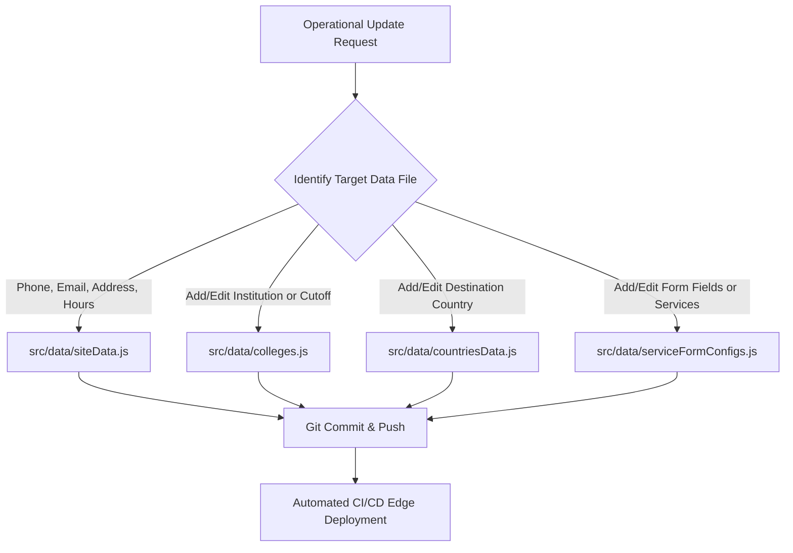

# Vidyapaths — Operations & Maintenance Manual

> **Step-by-step operational guide** for non-technical site managers and developers to update institution records, add study abroad destinations, maintain form schemas, and troubleshoot issues.

---

## 1. Maintenance Philosophy

The Vidyapaths codebase is structured with a **decoupled data layer** located in `src/data/`. Content modifications—such as updating cutoffs, changing phone numbers, or adding a new college—do not require touching complex React component logic or CSS stylesheets.



---

## 2. Managing Contact Information (`siteData.js`)

All contact coordinates are consolidated in `src/data/siteData.js`:

```javascript
// File: src/data/siteData.js
export const siteConfig = {
  name: "Vidyapaths",
  tagline: "Right Guidance. Brighter Future.",
  
  // Production contact tokens
  phone: "+91 98765 43210",              // Visual representation on Navbar & Footer
  phoneRaw: "+919876543210",            // Used for tel: links
  whatsappNumber: "+919876543210",      // Used for wa.me links (digits only with country code)
  whatsappMessage: "Hi Vidyapaths...",  // Default message loaded in WhatsApp
  email: "admissions@vidyapaths.com",    // Displayed in contact section
  formSubmitEmail: "admissions@vidyapaths.com", // Recipient address for lead emails
  address: "Knowledge Park, Sector 62, Noida, Uttar Pradesh 201309, India",
  hours: "Mon - Sat: 9:30 AM - 6:30 PM",

  socials: {
    instagram: "https://instagram.com/vidyapaths",
    linkedin: "https://linkedin.com/company/vidyapaths",
    facebook: "https://facebook.com/vidyapaths",
    youtube: "https://youtube.com/@vidyapaths"
  }
};
```

---

## 3. Maintaining the College Directory (`colleges.js`)

Institutions in `/colleges` are defined as objects in `src/data/colleges.js`:

### Institution Data Schema
```javascript
{
  id: "dtu-delhi",                             // Unique slug (lowercase, hyphenated)
  name: "Delhi Technological University (DTU)",// Official full name
  shortName: "DTU",                           // Acronym
  type: "State University",                   // Central / State / Private / Deemed
  location: "Shahbad Daulatpur, Delhi",       // Campus location
  accreditation: "NAAC A+",                   // NAAC or UGC accreditation status
  streams: ["Engineering", "Technology", "Management"], // Filter categories
  programs: [                                 // Key offered programs
    { name: "B.Tech Computer Engineering", duration: "4 Years" },
    { name: "MBA", duration: "2 Years" }
  ],
  cutoffs: "JEE Main Top 10k Rank / Direct counselling", // Admission criteria
  portalUrl: "https://dtu.ac.in",             // Official university admissions portal
  featured: true                              // Displays with a highlighted badge
}
```

### Steps to Add a New College:
1. Open `src/data/colleges.js`.
2. Locate the `collegesData` array.
3. Append a new object following the schema above.
4. Save the file and run `npm run build` to verify syntax.

---

## 4. Maintaining Study Abroad Destinations (`countriesData.js`)

Overseas country profiles in `/study-abroad` are defined in `src/data/countriesData.js`:

### Country Data Schema
```javascript
{
  id: "germany",
  name: "Germany",
  flag: "🇩🇪",
  topUniversities: [
    "Technical University of Munich",
    "Heidelberg University",
    "RWTH Aachen"
  ],
  popularCourses: ["Automotive Engineering", "Data Science", "Computer Science"],
  tuitionRange: "€0 – €3,000 / year (Public Universities tuition-free)",
  livingCosts: "€934 / month (Blocked Account Requirement)",
  stayBackPeriod: "18 Months Post-Study Work Permit",
  intakes: "Winter (October), Summer (April)",
  requirements: "IELTS 6.5+, APS Certificate for Indian Students"
}
```

---

## 5. Adding or Modifying Form Services (`serviceFormConfigs.js`)

The dynamic lead capture modal generates input fields using schemas in `src/data/serviceFormConfigs.js`:

### Service Schema Structure
```javascript
"new-service-id": {
  id: "new-service-id",
  title: "Service Display Name",
  description: "Brief explanatory caption.",
  fields: [
    {
      id: "fieldName",
      label: "Visual Label",
      type: "text", // "text" | "select" | "textarea" | "tel" | "email"
      placeholder: "Example placeholder...",
      required: true,
      options: ["Option 1", "Option 2"] // Only required if type === "select"
    }
  ]
}
```

---

## 6. Dependency Maintenance & Security Audits

Keep third-party packages updated and secure:

### Periodic Maintenance Routine
```bash
# 1. Check for known security vulnerabilities
npm audit

# 2. Fix minor patch vulnerabilities automatically
npm audit fix

# 3. Check for available minor/patch library updates
npm outdated

# 4. Run Oxlint to ensure code cleanliness
npm run lint

# 5. Run test build
npm run build
```

---

## 7. Common Troubleshooting Scenarios

### Problem 1: Form submissions succeed on screen but no email arrives in inbox.
- **Cause 1:** FormSubmit has not been activated for the production email.
  - *Fix:* Submit one form, check the inbox (and spam folder) for an email from FormSubmit titled *"Action Required: Activate FormSubmit"*, and click the confirmation link.
- **Cause 2:** The email address in `src/data/siteData.js` is still set to placeholder `admissions@vidyapaths.com`.
  - *Fix:* Replace it with a live client mailbox.
- **Cause 3:** FormSubmit rate limit exceeded.
  - *Fix:* Check `localStorage['vidyapaths_leads']` in the browser console. All leads are safely preserved locally.

### Problem 2: Navigating to sub-pages (e.g. `/colleges`) works, but pressing Refresh returns a 404 Not Found.
- **Cause:** The hosting provider is treating `/colleges` as a server folder instead of serving `index.html`.
  - *Fix for Vercel:* Ensure `vercel.json` exists with rewrite rules.
  - *Fix for Netlify:* Ensure `public/_redirects` exists with `/* /index.html 200`.

### Problem 3: WhatsApp button does not open the chat app.
- **Cause:** The phone number format contains extra spaces, symbols, or leading `+` in `whatsappNumber`.
  - *Fix:* Ensure `whatsappNumber` in `siteData.js` is pure digits including the country code (e.g. `919876543210` without `+` or spaces).
