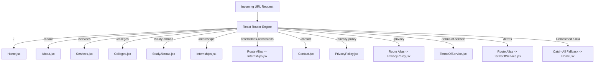

# Vidyapaths — Routing & Navigation Topology

> **Complete route mapping**, page metadata specifications, route aliases, hash anchor targets, and static hosting redirect mechanics.

---

## 1. Routing Architecture Overview

Vidyapaths utilizes **React Router v7** (`BrowserRouter as Router`) configured in `src/App.jsx`. All routing executes entirely client-side, enabling zero-latency page transitions without browser reloads.



---

## 2. Route Directory & Metadata Specifications

Each route is automatically synchronized with dynamic SEO document titles and descriptions by the `usePageMeta.js` hook:

| Path | Component File | Page Title (`document.title`) | Active Navbar Key | Canonical / Alias |
| :--- | :--- | :--- | :--- | :--- |
| `/` | `src/pages/Home.jsx` | `Vidyapaths — Right Guidance. Brighter Future. \| Career & Education Consultancy` | `Home` | Canonical |
| `/about` | `src/pages/About.jsx` | `About Vidyapaths \| Mission, Vision & Student-First Mentorship` | `About` | Canonical |
| `/services` | `src/pages/Services.jsx` | `Our Services \| College Admissions, Career Counselling & Study Abroad — Vidyapaths` | `Services` | Canonical |
| `/colleges` | `src/pages/Colleges.jsx` | `Explore Colleges & Courses \| UG, PG & Specialized Programs — Vidyapaths` | `Colleges` | Canonical |
| `/study-abroad` | `src/pages/StudyAbroad.jsx` | `Study Abroad Consultancy \| UK, USA, Canada, Australia & More — Vidyapaths` | `Study Abroad` | Canonical |
| `/internships` | `src/pages/Internships.jsx` | `Internship Assistance & Corporate Readiness — Vidyapaths` | `Internships` | Canonical |
| `/internships-admissions` | `src/pages/Internships.jsx` | `Internship Assistance & Corporate Readiness — Vidyapaths` | `Internships` | Alias for `/internships` |
| `/contact` | `src/pages/Contact.jsx` | `Contact Vidyapaths \| Book Free Career & Admission Counselling` | `Contact` | Canonical |
| `/privacy-policy` | `src/pages/PrivacyPolicy.jsx`| `Privacy Policy \| Vidyapaths` | — | Canonical |
| `/privacy` | `src/pages/PrivacyPolicy.jsx`| `Privacy Policy \| Vidyapaths` | — | Alias for `/privacy-policy` |
| `/terms-of-service`| `src/pages/TermsOfService.jsx`| `Terms of Service \| Vidyapaths` | — | Canonical |
| `/terms` | `src/pages/TermsOfService.jsx`| `Terms of Service \| Vidyapaths` | — | Alias for `/terms-of-service` |
| `*` | `src/pages/Home.jsx` | Defaults to Homepage metadata | — | 404 Fallback |

---

## 3. Hash Anchor Navigation & Viewport Offset

Certain high-intent conversion pathways leverage on-page anchor scrolling:

### Key Anchor: `#internship-process`
- **Location:** On `/internships` page, targeting the section *"How We Prepare You for Meaningful Internships"*.
- **Trigger:** Clicking the "Explore Process" button in the hero banner.
- **Offset Handling:** Because the website features a sticky navbar (approx. `72px` to `80px` tall), native browser anchor jumps would obscure the section title. The custom `ScrollToTop.jsx` component intercepts location hashes and performs an offset scroll:
  ```javascript
  const el = document.getElementById(hash.replace('#', ''));
  if (el) {
    const yOffset = -90; // Clear sticky navbar
    const y = el.getBoundingClientRect().top + window.pageYOffset + yOffset;
    window.scrollTo({ top: y, behavior: 'smooth' });
  }
  ```

---

## 4. Single-Page Application (SPA) Static Host Rules

Because Vidyapaths is an SPA, direct visits or hard page refreshes on sub-routes (such as `https://vidyapaths.com/colleges`) will trigger HTTP 404 errors on static hosts unless standard rewrite rules are configured.

### Configuration for Vercel (`vercel.json`)
```json
{
  "rewrites": [
    { "source": "/(.*)", "destination": "/index.html" }
  ]
}
```

### Configuration for Netlify (`public/_redirects`)
```
/*    /index.html   200
```

### Configuration for Apache (`.htaccess`)
```apache
<IfModule mod_rewrite.c>
  RewriteEngine On
  RewriteBase /
  RewriteRule ^index\.html$ - [L]
  RewriteCond %{REQUEST_FILENAME} !-f
  RewriteCond %{REQUEST_FILENAME} !-d
  RewriteRule . /index.html [L]
</IfModule>
```
