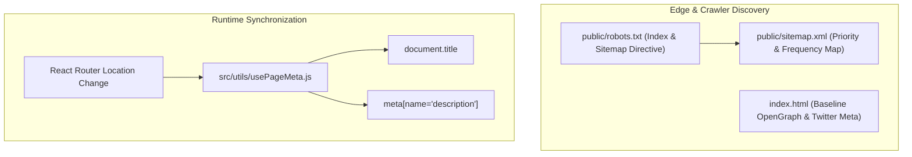

# Vidyapaths — Search Engine Optimization (SEO) & Performance

> **Comprehensive SEO specification** covering dynamic meta title injection, OpenGraph protocols, XML sitemaps, robots.txt directives, semantic HTML hierarchy, and Core Web Vitals optimization.

---

## 1. SEO Architecture Overview

Vidyapaths employs a **hybrid SEO methodology** combining static HTML baseline tags with client-side dynamic route synchronization to ensure search engine discoverability and social sharing previews.



---

## 2. Dynamic Route Meta Synchronization (`usePageMeta.js`)

In single-page applications, route transitions do not perform full browser reloads. Vidyapaths implements the `usePageMeta()` hook in `src/utils/usePageMeta.js`, which listens to route transitions and updates metadata dynamically:

### Route Metadata Registry

| Route Path | Synchronized Page Title | Meta Description |
| :--- | :--- | :--- |
| `/` | `Vidyapaths — Right Guidance. Brighter Future. \| Career & Education Consultancy` | *Vidyapaths is a student-focused Career & Education Consultancy helping students make confident decisions for college admissions, career guidance, internships, and study abroad.* |
| `/about` | `About Vidyapaths \| Mission, Vision & Student-First Mentorship` | *Learn about Vidyapaths, our ethical advisory philosophy, transparent college cutoffs analysis, and student-focused career guidance.* |
| `/services` | `Our Services \| College Admissions, Career Counselling & Study Abroad — Vidyapaths` | *Explore Vidyapaths comprehensive education guidance services: UG/PG admissions, career counselling, internship assistance, and international degrees.* |
| `/colleges` | `Explore Colleges & Courses \| UG, PG & Specialized Programs — Vidyapaths` | *Discover colleges and explore undergraduate, postgraduate, and specialized programs. Get personalized guidance to choose a course that fits your career goals.* |
| `/study-abroad` | `Study Abroad Consultancy \| UK, USA, Canada, Australia & More — Vidyapaths` | *End-to-end overseas education guidance for 9 top destinations: UK, USA, Canada, Australia, Germany, Ireland, New Zealand, UAE, and Singapore.* |
| `/internships` | `Internship Assistance & Corporate Readiness — Vidyapaths` | *Bridge academic learning with corporate exposure. Guidance on ATS resume optimization, project portfolios, and interview mastery.* |
| `/contact` | `Contact Vidyapaths \| Book Free Career & Admission Counselling` | *Get in touch with Vidyapaths academic counsellors. Request free 1-on-1 guidance, explore colleges, or chat directly on WhatsApp.* |

---

## 3. Social Graph & OpenGraph Protocols (`index.html`)

The root `index.html` file includes standardized OpenGraph and Twitter Card markup for link sharing across WhatsApp, LinkedIn, Facebook, and Twitter:

```html
<!-- Open Graph / Facebook -->
<meta property="og:type" content="website" />
<meta property="og:url" content="https://vidyapaths.com/" />
<meta property="og:title" content="Vidyapaths — Right Guidance. Brighter Future." />
<meta property="og:description" content="Student-focused Career & Education Consultancy: College Admissions, Career Counselling, Internships & Study Abroad." />
<meta property="og:image" content="/og-image.png" />

<!-- Twitter Cards -->
<meta property="twitter:card" content="summary_large_image" />
<meta property="twitter:title" content="Vidyapaths — Right Guidance. Brighter Future." />
<meta property="twitter:description" content="Student-focused Career & Education Consultancy: College Admissions, Career Counselling, Internships & Study Abroad." />
```

---

## 4. Search Bot Directives & XML Sitemap

### 4.1 Robots Directives (`public/robots.txt`)
Directs web crawlers to index the entire site and declares the location of the XML sitemap:
```
User-agent: *
Allow: /

Sitemap: https://vidyapaths.com/sitemap.xml
```

### 4.2 Search Engine Sitemap (`public/sitemap.xml`)
Declares prioritized canonical URLs with update frequencies:
```xml
<?xml version="1.0" encoding="UTF-8"?>
<urlset xmlns="http://www.sitemaps.org/schemas/sitemap/0.9">
  <url>
    <loc>https://vidyapaths.com/</loc>
    <changefreq>weekly</changefreq>
    <priority>1.0</priority>
  </url>
  <url>
    <loc>https://vidyapaths.com/services</loc>
    <changefreq>weekly</changefreq>
    <priority>0.9</priority>
  </url>
  <url>
    <loc>https://vidyapaths.com/colleges</loc>
    <changefreq>weekly</changefreq>
    <priority>0.9</priority>
  </url>
  <url>
    <loc>https://vidyapaths.com/study-abroad</loc>
    <changefreq>weekly</changefreq>
    <priority>0.9</priority>
  </url>
  <url>
    <loc>https://vidyapaths.com/internships</loc>
    <changefreq>weekly</changefreq>
    <priority>0.9</priority>
  </url>
  <url>
    <loc>https://vidyapaths.com/about</loc>
    <changefreq>monthly</changefreq>
    <priority>0.8</priority>
  </url>
  <url>
    <loc>https://vidyapaths.com/contact</loc>
    <changefreq>monthly</changefreq>
    <priority>0.8</priority>
  </url>
</urlset>
```

---

## 5. Semantic HTML & Accessibility Architecture

Search engines heavily reward well-structured content hierarchies:
1. **Singular `<h1>` Per Page:** Each page renders a single, descriptive H1 tag articulating its primary subject matter.
2. **Strict Heading Hierarchy:** Headings flow cleanly from `<h1>` -> `<h2>` -> `<h3>` without skipping levels.
3. **Descriptive Link Labels:** Buttons and navigation links avoid vague text such as "Click Here"; instead using action-oriented language such as "Explore Colleges Catalogue", "Apply for Free Consultation", and "View Cutoffs".
4. **Accessible Form Controls:** All form inputs feature paired visual `<label>` elements or accessible `aria-label` tags with associated placeholder text.

---

## 6. Core Web Vitals & Performance Strategy

The application is engineered to achieve top scores on Google PageSpeed Insights:
- **Largest Contentful Paint (LCP < 1.2s):** Preconnecting to Google Font servers (`fonts.googleapis.com` and `fonts.gstatic.com`) in `index.html` prevents render-blocking typography delay.
- **Cumulative Layout Shift (CLS ≈ 0.00):** Fixed icon bounding boxes, standardized card heights, and pre-allocated image containers eliminate visual jumping during page hydration.
- **Interaction to Next Paint (INP < 50ms):** Pure client-side state manipulation without heavy runtime frameworks guarantees immediate user response.
